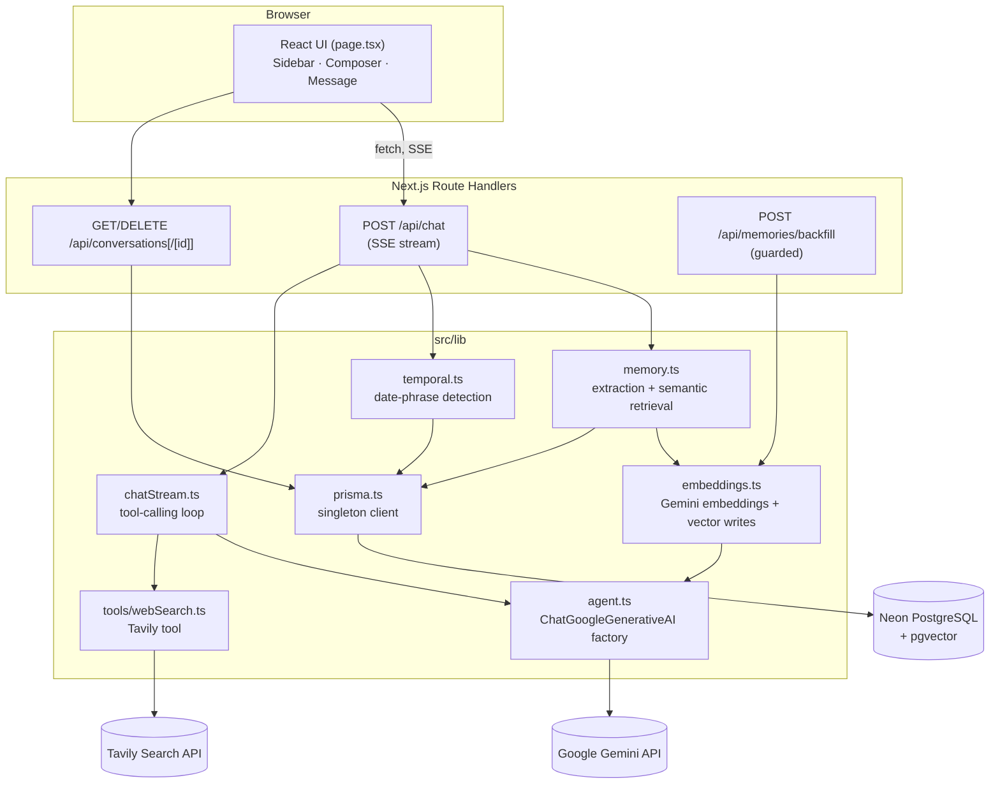
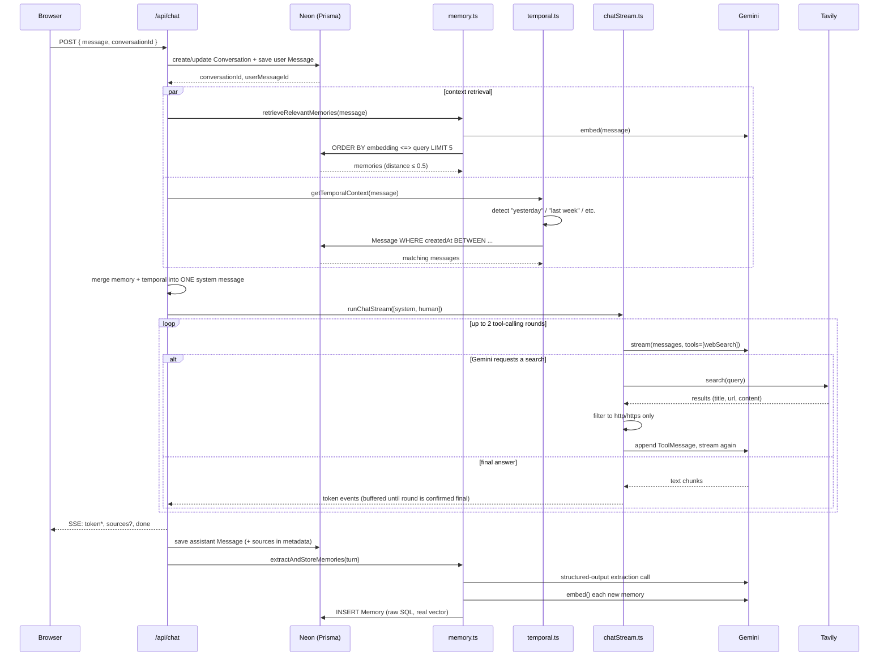
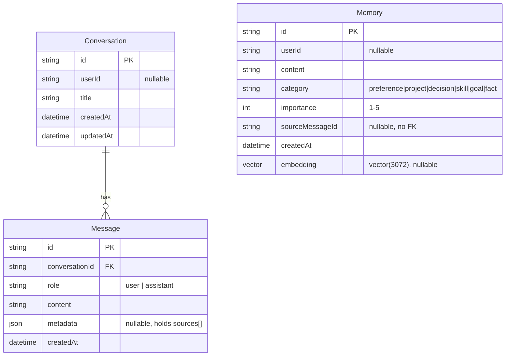

# MemoPy

A conversational AI assistant that remembers. MemoPy chats with you through Gemini, searches the live web with Tavily when it genuinely needs to, and recalls relevant facts and past conversations automatically — no "remember this" commands required.

- **Chat**: streamed Gemini responses over Server-Sent Events.
- **Web search**: Gemini decides when to call Tavily (current events, prices, versions — not general knowledge), capped at 2 searches per turn.
- **Memory**: durable facts ("prefers TypeScript", "building a Raspberry Pi project") are extracted from conversations, embedded, and retrieved by semantic similarity on future turns.
- **Temporal recall**: "what did we discuss yesterday?" is answered from actual stored message history, not guessed.
- **Persistence**: every conversation, message, and source citation survives a refresh.

---

## Tech stack

| Layer | Choice |
|---|---|
| Framework | Next.js 16 (App Router, Turbopack) |
| Language | TypeScript |
| Styling | Tailwind CSS v4 |
| LLM | Google Gemini, via `@langchain/google-genai` |
| Agent orchestration | LangChain JS (`bindTools`, no LangGraph) |
| Web search | Tavily, via `@langchain/tavily` |
| Database | PostgreSQL (Neon), via Prisma 7 |
| Vector search | pgvector (raw SQL — Prisma has no native vector type) |
| Embeddings | `gemini-embedding-001`, 3072 dimensions |

---

## System architecture

A modular monolith — one Next.js app, no separate backend service. Route Handlers call directly into small, single-purpose modules under `src/lib`.



---

## Data flow: one chat turn

This is the sequence `POST /api/chat` runs through for every message, from keystroke to persisted row.



Key properties:
- **Memory and temporal retrieval never block the chat.** Both are wrapped so that any failure (bad API key, DB hiccup) just logs and returns nothing — Gemini answers without that context instead of the request failing.
- **Tool-call narration never leaks into the answer.** Each round's text is buffered locally; it's only streamed to the client once that round is confirmed to have no tool calls. If Gemini says "let me check that..." before calling Tavily, that text is discarded, not shown.
- **Nothing incomplete is ever saved.** The assistant message is only written to the database after the stream finishes successfully; a mid-stream error sends an SSE `error` event and closes without touching the database.
- **Memory extraction happens after the user already has their answer**, using the same turn's text — it never delays the visible response.

---

## Database schema



`Memory` is intentionally not related to `Conversation`/`Message` by foreign key — it's a standalone long-term store, referencing its origin only informationally via `sourceMessageId`.

`embedding` is `Unsupported("vector(3072)")` because Prisma has no native pgvector type. One real consequence: Prisma's generated client **never** exposes an `Unsupported` column in typed `create`/`update` inputs, nullable or not — writing a real vector always goes through `$executeRaw`/`$queryRaw` (see `src/lib/embeddings.ts`).

---

## API reference

| Method | Path | Purpose |
|---|---|---|
| `POST` | `/api/chat` | Send a message. Body: `{ message: string, conversationId?: string \| null }`. Response: SSE stream (`token`, `sources`, `done`, `error`). Header: `X-Conversation-Id`. |
| `GET` | `/api/conversations` | List conversations, newest-updated first. |
| `GET` | `/api/conversations/[id]` | One conversation with its full, ordered message history (including `metadata.sources`). |
| `DELETE` | `/api/conversations/[id]` | Delete a conversation (messages cascade). |
| `POST` | `/api/memories/backfill` | Generate embeddings for any `Memory` rows with `embedding IS NULL`. Open in development; in production requires an `x-maintenance-secret` header matching `MAINTENANCE_SECRET`, or it 404s. Safe to re-run — already-embedded rows are skipped. |

### SSE event shapes (`/api/chat`)

```
event: token
data: {"text": "incremental "}

event: sources
data: {"sources": [{"title": "...", "url": "https://..."}]}

event: done
data: {}

event: error
data: {"message": "The response was interrupted. Please try again."}
```

---

## Memory and temporal retrieval, in detail

**Semantic memory** (`src/lib/memory.ts`, `src/lib/embeddings.ts`)
1. After a turn completes, Gemini is asked (via structured output, not free text) to extract only durable facts — preferences, projects, decisions, skills, goals — never greetings or one-off trivia. The prompt includes up to 30 existing memories so it can skip anything already known, which is the main deduplication mechanism at this stage.
2. Each surviving candidate gets embedded (`gemini-embedding-001`, 3072-dim) and inserted atomically with its vector in one `INSERT` — if embedding fails, that memory is simply not stored rather than being saved with a placeholder.
3. On a later turn, the user's message is embedded and compared against all stored memories via pgvector cosine distance (`<=>`), keeping only the top 5 within a distance of 0.5 (tuned empirically — looser thresholds let clearly unrelated memories leak into context).

**Temporal recall** (`src/lib/temporal.ts`)
1. A plain regex pass looks for `today`, `yesterday`, `last week`, a weekday name, `last N days`, `last month`, `earlier this month` — no LLM call, no NLP library.
2. Matched phrases become a UTC date range, computed with a fixed +5:30 offset (Asia/Kolkata has no DST, so no timezone library is needed).
3. Messages in that range are fetched directly from the `Message` table and formatted into a labeled block for Gemini. If nothing matches the detected range, Gemini is told so explicitly, so it says "I don't have anything from that time" instead of guessing.

Both retrieval results, when present, are merged into a **single** system message alongside the user's turn — Gemini's API only accepts one system message, so multiple context blocks are concatenated rather than sent as separate turns.

---

## Project structure

```
prisma/
  schema.prisma
  migrations/
src/
  app/
    api/
      chat/route.ts                  POST — SSE streaming chat
      conversations/route.ts         GET  — list conversations
      conversations/[id]/route.ts    GET, DELETE — one conversation
      memories/backfill/route.ts     POST — embedding backfill (guarded)
    layout.tsx, page.tsx, globals.css
  components/
    Sidebar.tsx    conversation list, collapse toggle, theme toggle, delete
    Composer.tsx   auto-growing message input
    Message.tsx    markdown rendering, copy action, source links
    EmptyState.tsx welcome screen + suggested prompts
    icons.tsx      inline SVG icons
  lib/
    agent.ts        ChatGoogleGenerativeAI factory
    chatStream.ts   bounded tool-calling loop → SSE event generator
    embeddings.ts   Gemini embeddings, raw-SQL vector writes, backfill
    memory.ts       extraction, dedup, semantic retrieval
    temporal.ts     date-phrase detection, UTC boundary math
    prisma.ts       PrismaClient singleton (pg driver adapter)
    tools/webSearch.ts   Tavily tool factory
```

---

## Environment variables

See `.env.example` for the authoritative list with inline comments. Summary:

| Variable | Required | Notes |
|---|---|---|
| `DATABASE_URL` | yes | Neon **pooled** connection — used by the app at runtime |
| `DIRECT_URL` | yes | Neon **direct** connection — used only by the Prisma CLI for migrations |
| `GOOGLE_API_KEY` | yes | Gemini API key |
| `GEMINI_MODEL` | no | Defaults to `gemini-flash-latest` |
| `TAVILY_API_KEY` | yes | Tavily API key |
| `MAINTENANCE_SECRET` | production only | Protects `/api/memories/backfill`; unset = endpoint always 404s in production |

---

## Getting started

```bash
cp .env.example .env   # fill in real values
npm install            # also runs `prisma generate` via postinstall
npx prisma migrate deploy   # apply migrations to your database
npm run dev
```

Open [http://localhost:3000](http://localhost:3000).

## Build & checks

```bash
npx tsc --noEmit   # typecheck
npm run lint
npm run build
```

`npm run build` does not require any environment variables to be set — Prisma's driver adapter doesn't connect at module-construction time, and every API route is dynamic (not statically prerendered).

## Deployment notes

- `src/generated/prisma` is gitignored by design; the `postinstall` script (`prisma generate`) regenerates it on every fresh install, including on Vercel.
- `/api/chat` sets `maxDuration = 60` — multi-round tool-calling responses can legitimately take 15–20+ seconds.
- Prisma's driver-adapter mode (`@prisma/adapter-pg`) means no platform-specific query-engine binary is needed, which sidesteps a common source of Vercel deployment friction with classic Prisma setups.
- Set `MAINTENANCE_SECRET` in your deployment's environment variables before you'll be able to call the backfill endpoint there.

---

## Known limitations

- Single-user MVP — no authentication; `userId` fields exist in the schema but are unused.
- Mobile shows a slim header only, no conversation list/switcher (desktop has the full collapsible sidebar).
- Memory deduplication relies on an LLM-provided "already known" list plus exact-string matching, not true semantic dedup.
- No pagination on the conversation list.
- Tool-calling rounds buffer their text server-side before streaming, so the very first token of a response that doesn't need a search arrives slightly later than true token-by-token streaming would — a deliberate trade for never leaking a tool-call round's narration into the displayed answer.
